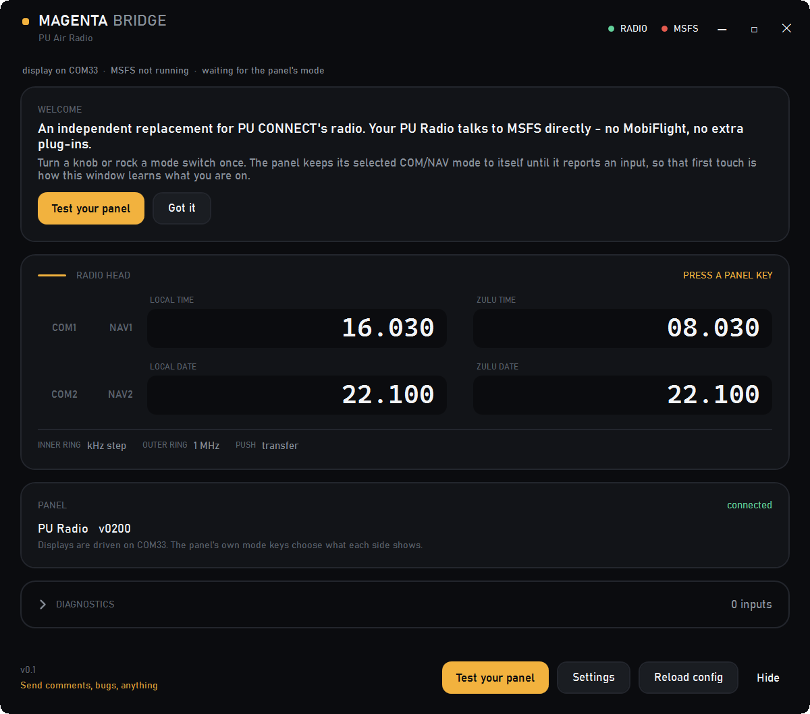
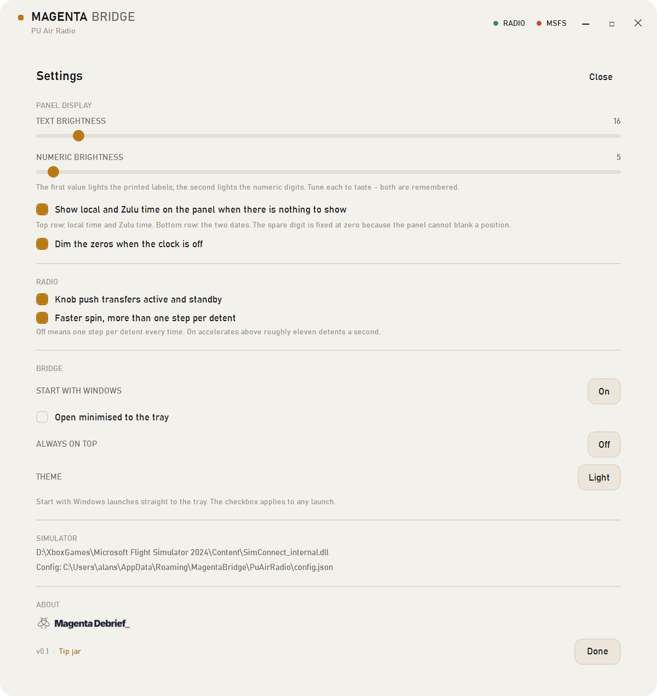

# Magenta Bridge for PU Air Radio



An independent Windows client for the **PU Radio** panel in Microsoft Flight Simulator 2024.
Free, MIT, no telemetry, no MobiFlight, no vendor plug-in.

It does the radio, in one window of its own: the panel's knobs tune the sim, the four readouts show what the sim actually has, and the window says what is connected.

```
COM1 active 133.800  standby 132.850
COM2 active 124.850  standby 124.725
```

**[Download for Windows](https://github.com/flyingsotong/magenta-bridge-pu-air-radio/releases/latest)** ·
[Product page](https://magentadebrief.com/magenta-bridge-pu-air-radio/) ·
[The panel review](https://magentadebrief.com/pu-air-korea-radio-review/)

## Why

The panel presents itself to Windows as two devices on one cable: a game controller carrying every
switch and ring, and a serial port driving the four displays. Anything can read the inputs, while
the displays take one program at a time.

PU CONNECT covers the radio, and this was written against a panel behaving exactly as PU CONNECT
leaves it. What is different here is the shape of the client: the radio only, both rows in one
window the way a radio head shows them, and the state of each link named when something is wrong.

One detail is worth knowing before taking a panel apart. PU CONNECT stores the digit brightness,
and at zero the digits become unreadable, so the panel looks dead while Windows and the sim both
still see it. That setting lives in this client's own settings, and both fields are remembered.

## Requirements

- Windows 10 or 11 (x64)
- Microsoft Flight Simulator 2024 (2020 should work; tested on 2024)
- PU Radio, plugged into USB

## Install

1. Copy the `MagentaBridge-PuAirRadio` folder anywhere you like.
2. Run `MagentaBridge-PuAirRadio.exe`.
3. If MSFS is already running it connects by itself; otherwise it waits and connects when you start
   the sim. The header dots show RADIO and MSFS independently.

It is self-contained - no .NET runtime to install, no driver, no SimConnect redistributable.

Close PU CONNECT while it runs. The panel's serial port takes one program, and the window says
which one has it and offers a **Close PU CONNECT** button rather than closing it silently.

### First launch

The panel keeps its selected COM/NAV mode inside its own firmware and only reports it when a
control changes. Until you touch something, nothing on the wire says which row is COM and there
are no frequencies to show, so the panel runs its clock and the window says **PRESS A PANEL KEY**.

Turn a knob or rock a switch once. After that the panel's mode switches drive the mode: the app
follows the hardware, never the other way round. The clock comes back whenever the sim is not
running.

### If MSFS lists the panel as a game controller

Windows exposes the panel as a game controller. MSFS may have bound its buttons to sim actions the
first time it was plugged in, which would make one press do two things. In
**MSFS Options > Controls**, select the PU Radio device and clear its assignments (or assign it an
empty profile). The bridge reads the raw HID reports and does not care either way.

## The controls

The panel has two rows. Everything is on the row it affects.

| Control | What it does |
|---|---|
| Small switch, top (COM1 / NAV1) | Selects which radio the top row shows and tunes |
| Small switch, bottom (COM2 / NAV2) | Same for the bottom row |
| Top knob, inner ring | Top radio standby: 25 kHz steps on COM, 50 kHz on NAV |
| Top knob, outer ring | Top radio standby: 1 MHz steps |
| Top knob push | Transfer top radio active and standby |
| Bottom knob, inner ring | Bottom radio standby: 25 kHz on COM, 50 kHz on NAV |
| Bottom knob, outer ring | Bottom radio standby: 1 MHz steps |
| Bottom knob push | Transfer bottom radio active and standby |

The panel prints COM frequencies with the leading 1 implied, so 118.800 appears as `18.800`. The
window shows the whole frequency; both agree.

## Settings




- **Text brightness** and **numeric brightness** - the two brightness fields the firmware takes.
  Both are remembered.
- **Show local and Zulu time when idle** - uses the panel as a clock before the sim connects, in
  the menus, and after it quits. The panel's five-digit fields make it read as `11.100` for 11:10;
  the spare digit is fixed at zero because the hardware cannot blank a position.
- **Dim the zeros when the clock is off** - only applies if the clock is switched off.
- **Knob push transfers active and standby** - turn it off if you would rather the push did
  nothing.
- **Faster spin, more than one step per detent** - off by default. One click is one step; turning
  it on lets a fast spin cover more ground, at the cost of precision.
- **Start with Windows**, **Always on top**, **Open minimised to the tray**, **Theme**.

`Esc` hides to the tray. `Ctrl+L` copies the log. The tray icon has the same actions as the window.

## What it does

- COM1/COM2 and NAV1/NAV2 tuning and transfers
- Live active and standby frequencies on the panel and in the window
- COM/NAV mode follows the panel's own switches
- A clock on the panel whenever there is nothing to show: local and Zulu time on the top row, the two dates on the bottom
- Display brightness, remembered per user
- Auto-reconnect: unplug and replug the panel, start or quit MSFS, and it picks up again
- Honest states: dashes when there is no data, the reason in the window when something is wrong
- Guided self-test that exercises every switch, push and ring

## Limitations, stated plainly

- **The panel's own scanning misses inputs.** An independent HID capture, with no bridge running,
  saw roughly half the detents from a brisk turn. Light taps and fast flicks can be lost, and the
  knob push sometimes needs a deliberate half-second press. This is the panel's firmware, not the
  bridge; PU CONNECT loses the same ones. Turn deliberately.
- **Aircraft that do not use the standard radio events will not respond.** The bridge sends the
  standard COM/NAV SimConnect events that default aircraft and most add-ons honour. A study-level
  airliner with its own radio management panel may ignore them; nothing short of a WASM module can
  reach those, and that is out of scope for this release.
- **8.33 kHz spacing depends on the aircraft.** The display handles three decimals; the tuning
  events are the sim's, so whether you can reach an 8.33 channel is the aircraft's decision.
- **One panel at a time.** Two PU Radios on one PC is not supported.
- **The clock has one spare digit per field.** Local and Zulu time read as HH.MM with a trailing
  zero (`11.100` for 11:10), and the dates as DD.MM with the same. The panel has no way to blank a
  digit position, so this is the closest a five-digit radio display gets to a clock.

## How it works

For anyone maintaining this later, or building the next Magenta Bridge.

**HID input.** USB `VID_2777 PID_8777`, one HID interface (usage page 1, usage 4) plus one CDC
serial port. Report id `0x14`, 5 bytes. Fourteen buttons in the first two data bytes, little
endian, usage *n* at bit *n-1*:

| Usage | Meaning |
|---|---|
| 1, 2 | top row's latched mode: COM1, NAV1 |
| 3, 4 | bottom row's latched mode: COM2, NAV2 |
| 5, 6 | top and bottom knob push |
| 7, 8 | top inner ring anti-clockwise / clockwise |
| 9, 10 | top outer ring anti-clockwise / clockwise |
| 11, 12 | bottom inner ring |
| 13, 14 | bottom outer ring |

The mode bits are state, not presses. The rocker's contacts bounce for up to a second, so the mode
is only believed after 220 ms of stability. The encoder frequently reports a moment with both
direction bits set as the wiper crosses the midpoint; counting both cancels the click, which is
where skipped tuning comes from. A ring therefore counts at most one step per press and waits
for an ambiguous report to resolve.

**Serial output.** The display is driven over the panel's CDC port at 9600 8N1, one line, every
250 ms or when something changes:

```
RADIO,<textBrightness>,<act1>,<stb1>,<act2>,<stb2>,<o1>,<o2>,<numericBrightness>\n
```

- Frequencies are integers in kHz (`118800`).
- `o1` is `11` for COM and `10` for NAV; `o2` is `21` / `20`.
- Brightness is 0-250. Zero does not switch the digits off, which is why the idle state is dim
  zeros rather than a dark panel.
- The port must stay open: the firmware falls back to its own demo pattern when the host lets go.
- Never send an empty field. The firmware's parser stops until the panel is power-cycled.

**SimConnect.** Eight frequency variables at visual-frame rate, plus `TITLE` once a second, and
twenty mapped events (whole/fraction step and transfer for four radios). The client DLL is
discovered from the sim's own install rather than shipped.

## The Magenta Bridge family

[Magenta Bridge for Octavi IFR-1](https://github.com/flyingsotong/magenta-bridge-octavi-ifr1) does
the same job for Octavi's panel and has its own
[page](https://magentadebrief.com/magenta-bridge/). This build is the second client, made at my
own desk for the panels I fly with. Both are free and MIT.

## Uninstall

Close the app from the tray, delete its folder, then remove the startup entry if you enabled it
(`HKCU\Software\Microsoft\Windows\CurrentVersion\Run`, value `Magenta Bridge (PU Air Radio)`) and
the settings at `%APPDATA%\MagentaBridge\PuAirRadio`.

## License

MIT. Not affiliated with PU AIR KOREA and not endorsed by them. PU Radio is their product; this is
an independent client written against its observable behaviour. PU CONNECT remains the vendor's
supported software.
